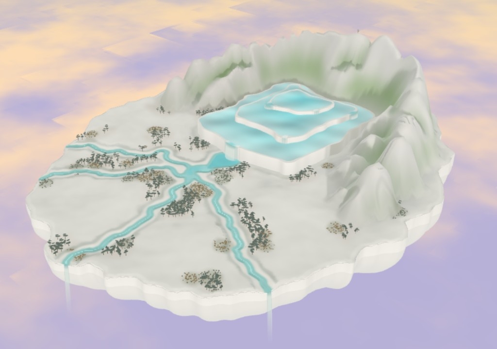
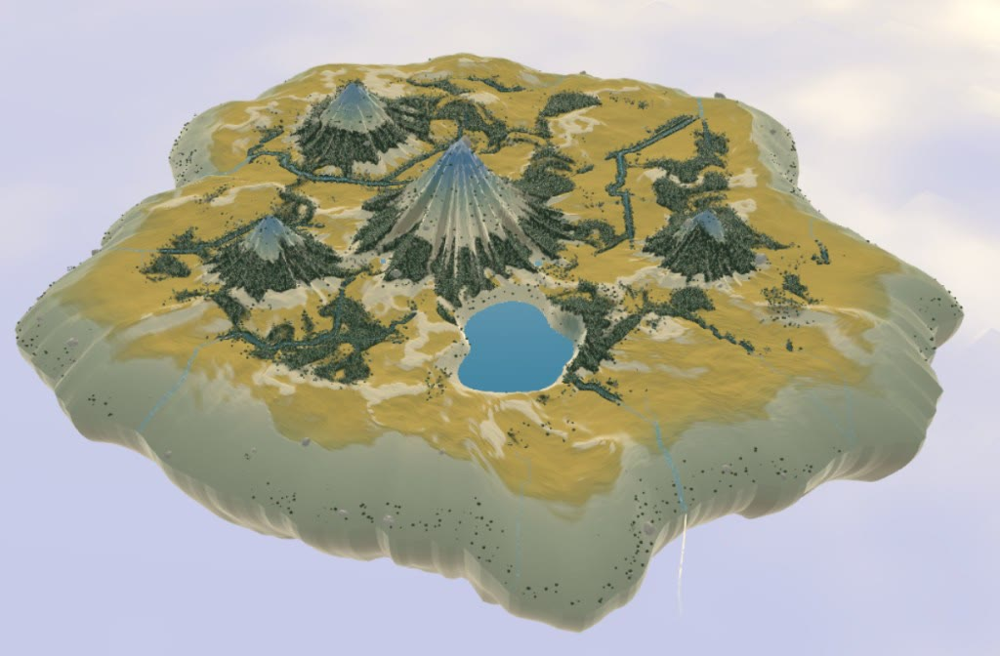
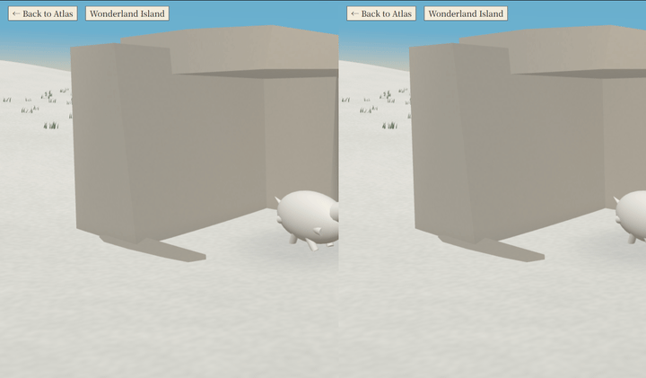
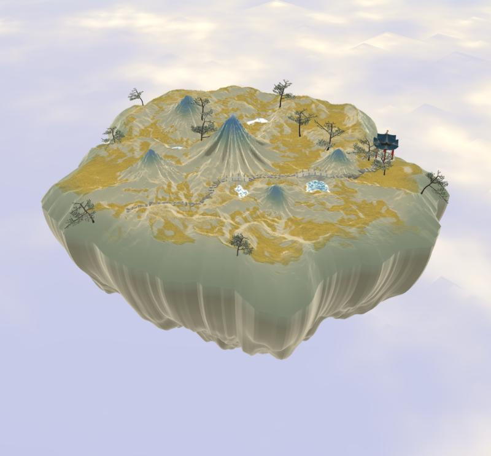
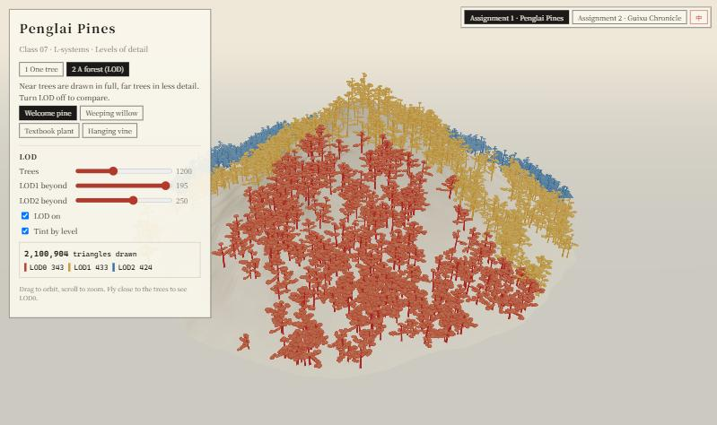
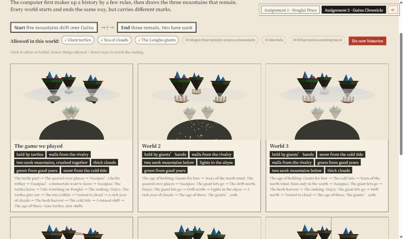
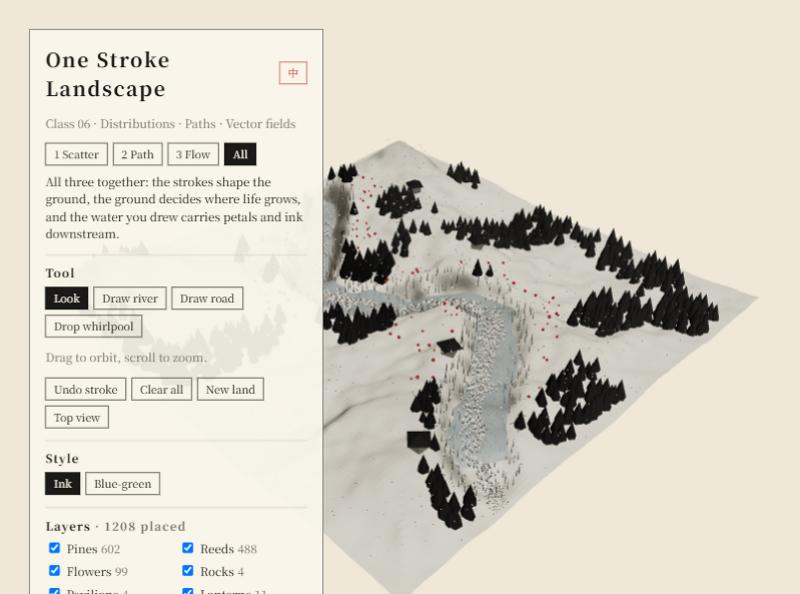
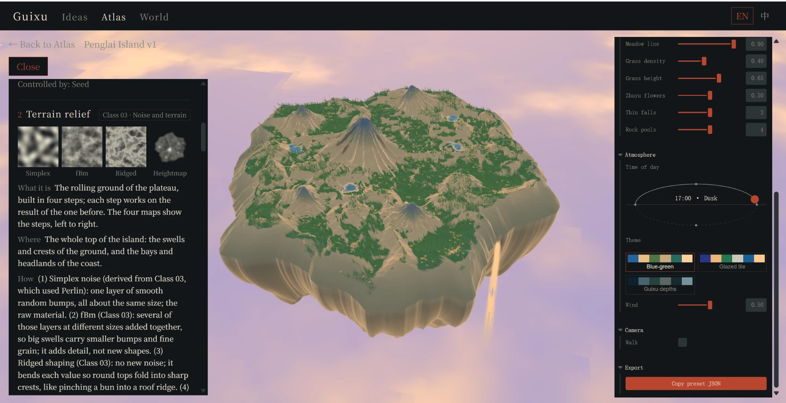
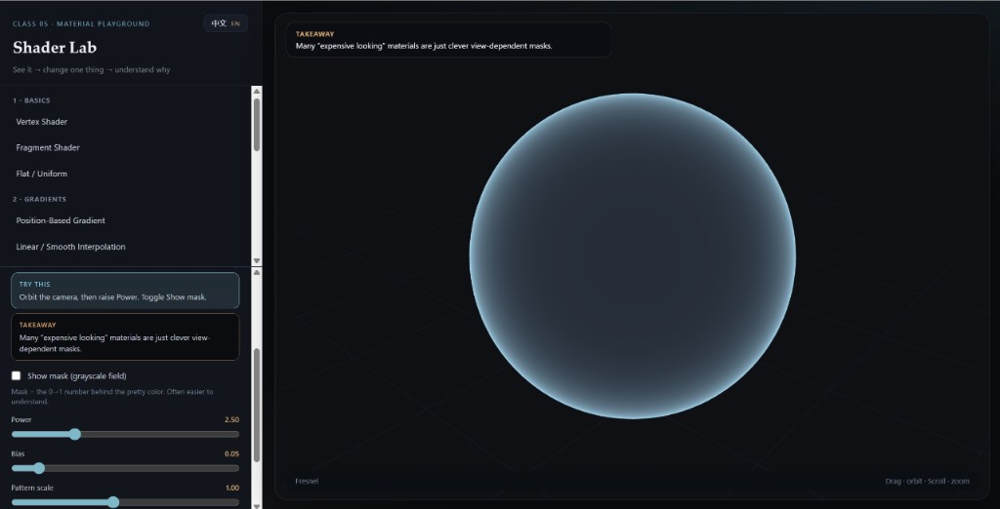
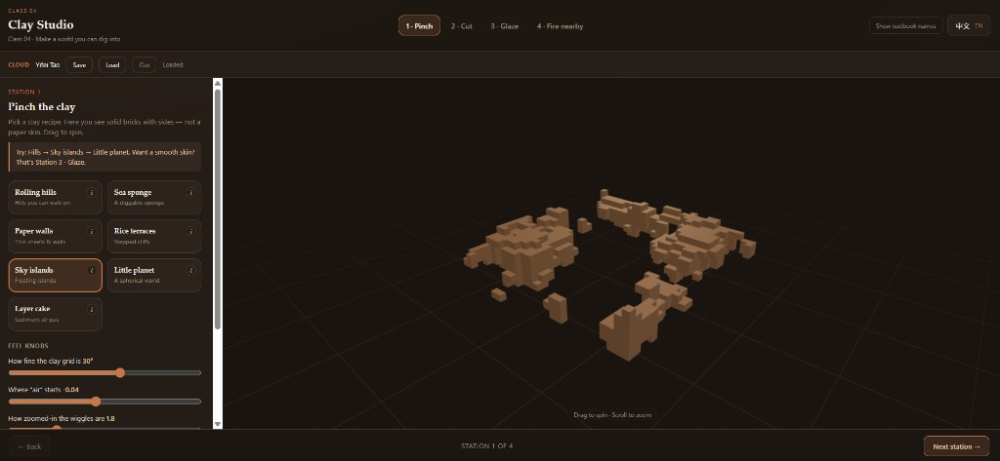

# Guixu 归墟



**White Jade Island** is the island I am building now: white porcelain ground, a terrace of pools, streams that leave the rim, and a creature whose days slowly turn the stone it touches toward jade.

Live: [White Jade Island](https://guixu-yt684.web.app/#/atlas/wonderland-terrain)

```bash
cd final_project
npm install
npm run dev
```

Then open `#/atlas/wonderland-terrain`. Seed **684**.

## Open

| | What you see | Open |
| --- | --- | --- |
| **White Jade Island** | Porcelain island, streams, the creature and its rock shelter | [Live](https://guixu-yt684.web.app/#/atlas/wonderland-terrain) · [Atlas card](https://guixu-yt684.web.app/#/atlas) |
| **Penglai Island** | The first island: pines, wind, the 24 solar terms, paths and pavilions | [Live](https://guixu-yt684.web.app/#/atlas/island-v1) |
| **Atlas** | Both islands and the class exercises, each with a short note | [Live](https://guixu-yt684.web.app/#/atlas) |

| Penglai | A day at the shelter |
| --- | --- |
| [](https://guixu-yt684.web.app/#/atlas/island-v1) | [](final_project/docs/rock-shelter-slab-2026-10-28.md) |

Shelter notes and the other frames: [`final_project/docs/rock-shelter-slab-2026-10-28.md`](final_project/docs/rock-shelter-slab-2026-10-28.md).

## Class exercises

Earlier studies. Each one was turned toward Guixu and also opens from the Atlas.

| Class | Piece | Code | Notes |
| --- | --- | --- | --- |
| 07 | Penglai Pines · Guixu Chronicle | [`class_07/react-app-ts/`](class_07/react-app-ts/) | [Pines](class_07/tutorials/Penglai%20Pines.md) · [Chronicle](class_07/tutorials/Guixu%20Chronicle.md) |
| 06 | One Stroke Landscape | [`class_06/react-app-ts/`](class_06/react-app-ts/) | [Notes](class_06/tutorials/One%20Stroke%20Landscape.md) |
| 05 | Shader Lab | [`class_05/react-app-ts/`](class_05/react-app-ts/) | [Notes](class_05/tutorials/Shader%20Lab.md) |
| 04 | Clay Studio | [`class_04/react-app-ts/`](class_04/react-app-ts/) · [Live](https://pwb-class04-clay.web.app) | [Notes](class_04/tutorials/) |
| 03 | Island terrain | [`class_03/react-app-ts/`](class_03/react-app-ts/) | [Notes](class_03/tutorials/Noise%20and%20Procedural%20Terrain.md) |

## Run the apps

| App | Folder | Live |
| --- | --- | --- |
| Final project | [`final_project/`](final_project/) | [guixu-yt684.web.app](https://guixu-yt684.web.app) |
| A class exercise | `class_XX/react-app-ts/` | Atlas, or that folder's own dev server |

```bash
cd final_project   # or class_02/react-app-ts, and so on
npm install
npm run dev
```

Each folder is its own Vite app. They share this git history and are deployed separately.

## Process

Newest first. The front of this page is the project; this log is how it got here.

### 2026-10 · Midterm — Guixu 归墟: the atlas, and a living Penglai

For the midterm exhibition (Oct 14) the site became one **atlas**: the class exercises 03–07 were reworked around Guixu and now open inside the site (back / previous / next), each card saying what I learned and what it becomes in the world. Then Penglai, the first island, got the techniques from Sessions 6 and 7 and a year to live in:

- **Huangshan pines (L-systems + LOD, Session 7).** Weighted rules grow a bent trunk that stops and spreads into a flat crown, level limbs in layers, one long arm reaching over the void, and short stiff needles all along the young shoots, closing into a brush at each tip (after photos of Huangshan pines and their needles). Three LODs, all cut at the same branch level so the outline never jumps: about 29k → 6k → 3k triangles per tree.
- **Wind as a vector field (Session 6).** Prevailing wind + ideal flow around every peak (faster on the flanks, calm in the wake) + curl noise, packed into one small texture that every shader reads; optional drifting streaks show it.
- **The 24 solar terms.** The year is one number from 0 to 24: grass grows and turns gold, snow settles on the summits and the pines, the Zhuyu flowers bloom only in season, the sun climbs and sinks. It opens on today's term; drag the bar or let the year play (two minutes a year).
- **Paths and pavilions (Session 6 paths + a shape grammar).** The visitor clicks two points; A* on the terrain chooses the route, stone steps where it climbs, a stone arch where a pool or deep gully is in the way, and the stones are laid one by one. If the end is flat ground with a view, the path snaps to it and a pavilion is built there from a small grammar (4, 6 or 8 sides, single or double eaves), every one different.
- **Feedback from class, addressed.** Grass was too tall next to the peaks (now 0.1–0.6 m); the camera no longer clips into the rock.
- **Interface.** A paper-and-ink panel (rice-paper ground, ink text, cinnabar used sparingly), a guided first path, and a techniques panel checked for repeats and contradictions.
- **Performance, measured.** Drawing a frame takes about 3 ms; the lag came from rebuilding the island on every step of a slider (about 1.2 s each at mesh resolution 256). The island now rebuilds once the slider rests, and the pixel ratio is capped at 1.5 for retina screens.



- **AI workflow**: Claude Code built; I directed and judged each round from screenshots and reference photos. Several things were rejected and redone: a pavilion that assembled itself (not procedural, so removed), rope bridges (too frequent, now stone arches only), ink "search" dots over the whole island (removed), and pines whose needle pads read as cactus discs (rebuilt as needles along the shoots). I asked for numbers before any optimization, which showed the slowdown was rebuilding, not drawing.
- **Next**: creatures for Session 9 (Shanhaijing entries, "shaped like A but with B"), then the other four islands and the voxel caves of Daiyu.
- App: [`final_project/`](final_project/) · Live: [https://guixu-yt684.web.app](https://guixu-yt684.web.app)
- Notes: [`final_project/src/experiments/island-v1/notes.md`](final_project/src/experiments/island-v1/notes.md)

### 2026-10 · Class 07 — Penglai Pines 蓬莱松 & Guixu Chronicle 归墟编年 (L-systems · LOD · branching worlds)

Two small pieces, one per assignment, in one app (switch at the top right, EN/中文).

**Assignment 1, Penglai Pines (L-systems + LOD).** A tree written as a few rules: a stochastic L-system grammar is expanded a few generations, then read by a 3D turtle into branches and flat cloud-like needle pads.
- **Presets**: Huangshan welcome pine, weeping willow (same kind of grammar, heavy gravity), the textbook plant `F = F[+F]F[-F]F`, and a vine hanging under a floating rock. Rules can be edited live, and the string is shown generation by generation.
- **LOD from recursion depth**: LOD0 keeps every twig; LOD1 drops twigs and merges their pads; LOD2 keeps only the trunk and one pad per limb (pine: 4,590 → 1,232 → 132 triangles).
- **Forest**: 1,200 instanced pines on a mountain choose their level by camera distance every frame. In one measured view, about 0.7 M triangles are drawn with LOD on versus 5.2 M with it off. *Tint by level* shows the rings.



**Assignment 2, Guixu Chronicle (procedural world building).** I played a short game of *Microscope* (with Claude, for lack of classmates nearby), with fixed bookends from the *Liezi*: five mountains drift over Guixu → three remain, two have sunk. Then I turned it into a system: the ending becomes a list of things that must happen, each with several possible causes filtered by the palette (what this world allows). The computer generates a history and then **draws the world that history leaves behind**: turtles, cloud pillars or giants' hands under the mountains, walls from the rivalry, a giant's fishing line, sunk mountains below, lights in the abyss. Six worlds share the same start and end, and each carries different marks.



- **AI workflow**: Claude Code built both apps. For Assignment 2 the first version was a text card table that felt too abstract, so we switched to "history → visible traces", which made the idea of a procedural world concrete for me.
- App: [`class_07/react-app-ts/`](class_07/react-app-ts/)
- Notes: [`class_07/tutorials/Penglai Pines.md`](class_07/tutorials/Penglai%20Pines.md) · [`class_07/tutorials/Guixu Chronicle.md`](class_07/tutorials/Guixu%20Chronicle.md)

### 2026-10 · Class 06 — One Stroke Landscape 一笔山河 (scatter · paths · vector fields)

One interactive piece for the three assignments of the class (distributions, paths, vector fields and particles). Draw a stroke on an empty landscape: it becomes a **river** that carves the ground (or a **road** that levels it and gets lanterns); life **regrows around it by rules**; and the water you drew **flows**, carrying thousands of particles that leave brush-stroke trails. Four chapters (Scatter · Path · Flow · All), ink-wash and blue-green styles, EN/中文.

- **Scatter**: one rule layer per asset, reading height, slope, moisture and distance to water and road: rocks only on cliffs, reeds on banks, pines in clumps on gentle slopes (smaller up high, greener where wet), flowers on wet flat ground, pavilions on the flattest high spots, lanterns along roads.
- **Path**: mouse points → Catmull-Rom spline → draped on the terrain; the line carves or levels the mesh, and the mesh's moisture moves the vegetation.
- **Flow**: a vector field summed from the river current (in the drawn direction), whirlpools you drop, and curl-noise wind; particles read it every frame and draw fading trails.
- **AI workflow**: rebuilt from scratch with Claude Code after a first version felt dull and hard to use: I chose the concept (one integrated piece in three chapters) and the priorities (clear concepts, smooth, not over-detailed), and tested the interactions.



- App: [`class_06/react-app-ts/`](class_06/react-app-ts/)
- Notes: [`class_06/tutorials/One Stroke Landscape.md`](class_06/tutorials/One%20Stroke%20Landscape.md)

### 2026-09 · Final project — Guixu 归墟: Penglai Island v1 (first floating island)

Started the final project: **Guixu**, five floating mountains above a sea of cloud and the bottomless abyss beneath them, drawn from the *Liezi* and the *Shanhaijing*, colored after blue-green landscape painting, lit like *Sky*. Built the site (Ideas · Atlas · World, EN/中文) and the first island study, **Penglai**, where everything is generated from rules and a seed:

- **Terrain**: Simplex noise → fBm → ridged shaping → heightmap; natural stone peaks from distance masks, merged by smooth union and painted ochre → malachite → azurite per peak.
- **Underside**: the same heightmap idea hung upside down: a cliff wall and a few blunt hanging rocks.
- **Water**: thin falls (noise streaks sliding down in a shader) and rock pools carved into hollows (Fresnel reflection of the sky).
- **Life**: instanced grass bending in one shared wind; *Zhuyu* flowers that open by day and glow at night.
- **Look and feel**: three palettes (blue-green, glazed tile, Guixu depths), a warm-gold and lavender cloud sea, a draggable sun, and a first-person **walk** (WASD) across the island.
- **Techniques panel**: every step explained (what / where / how) with its class source and a live map.

**AI workflow**: Claude Code as the builder, me as author and critic. A handover doc set the rules (everything procedural, plan before code, measure every change); each round I reviewed screenshots, drew corrections on them (for example the underside went from "knife cuts" to a twisted stem to an "upside-down cactus" before landing on blunt hanging rocks), and asked for the principle behind each technique so I can explain it. Every change and its measurements are logged in the project notes.

**Next**: wind as a real vector field (Session 6), L-system pines (Session 7), seasons driven by the 24 solar terms, and the other four islands.



- App: [`final_project/`](final_project/)
- Live: [https://guixu-yt684.web.app](https://guixu-yt684.web.app)
- Notes: [`final_project/src/experiments/island-v1/notes.md`](final_project/src/experiments/island-v1/notes.md) · World concept: [`final_project/docs/world-concept.md`](final_project/docs/world-concept.md)

### 2026-09 · Class 05 — Shader Lab (see → tweak → understand)

Built a **Shader Lab** playground for class shader studies: vertex / fragment / uniforms, gradients, Fresnel, slope, distance, AO, contact, matcap, displacement, and a final combo. EN/中文 UI, "try this / takeaway / show mask," and a suggested learning path — more material laboratory than documentation site.



- App: [`class_05/react-app-ts/`](class_05/react-app-ts/)
- Notes: [`class_05/tutorials/Shader Lab.md`](class_05/tutorials/Shader%20Lab.md)

### 2026-09 · Class 04 — Clay Studio (voxels → clear UI → Firebase)

Explored **voxel / density** experiments from lecture, then reshaped them into a simpler, beginner-friendly **Clay Studio** app (pinch · cut · glaze · fire nearby). Deployed to **Firebase Hosting** with **Google sign-in** and **save / load** of studio settings via **Firestore**.



- App: [`class_04/react-app-ts/`](class_04/react-app-ts/)
- Live: [https://pwb-class04-clay.web.app](https://pwb-class04-clay.web.app)
- Notes: [`class_04/tutorials/`](class_04/tutorials/)
