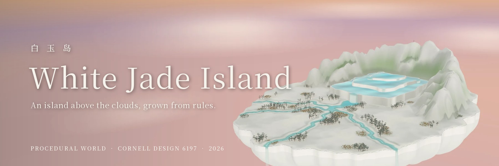
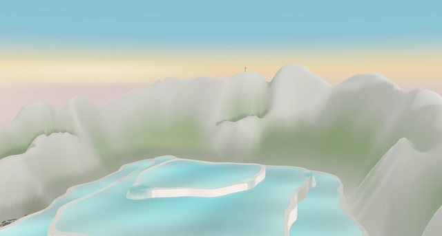
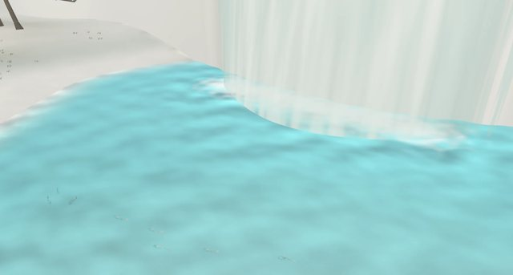
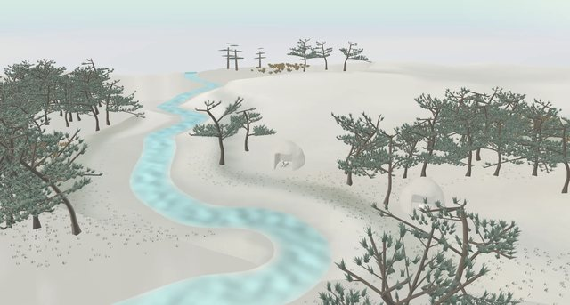
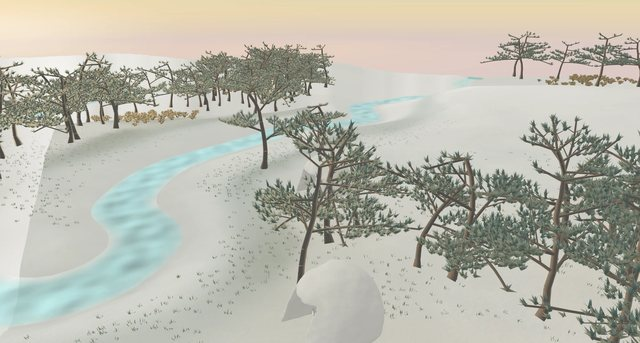
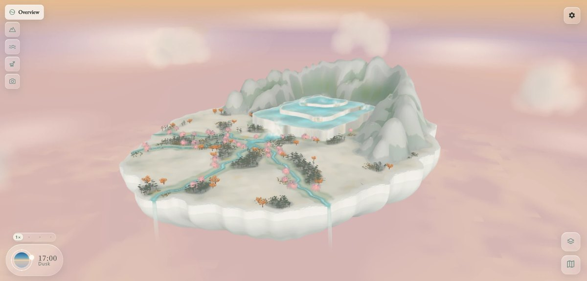
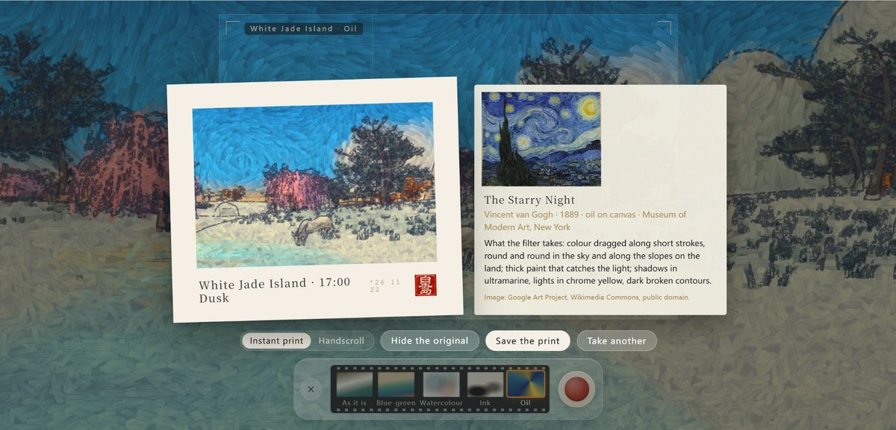
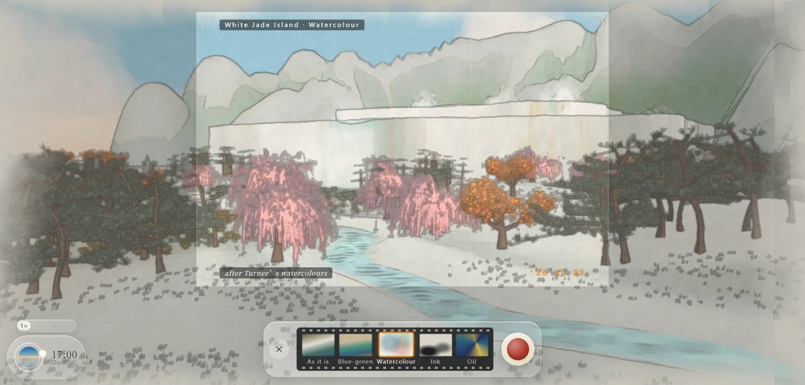
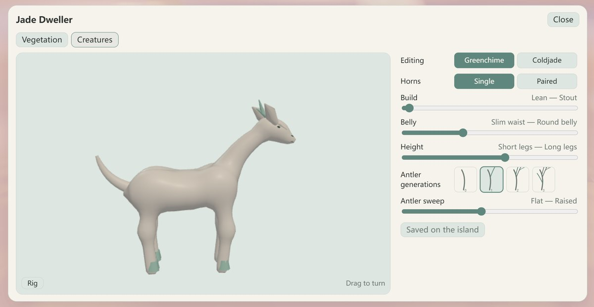
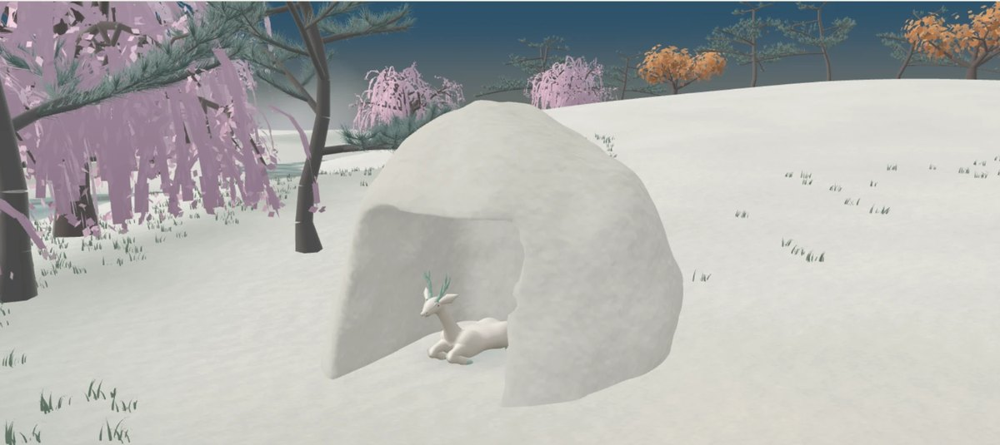

  <a href="https://whitejadeisland.web.app/#/world"><b>▶ Enter the island</b></a> &nbsp;·&nbsp;
  <a href="https://whitejadeisland.web.app/">How it grows</a> &nbsp;·&nbsp;
  <a href="https://whitejadeisland.web.app/#/atlas">Atlas</a> &nbsp;·&nbsp;
  <a href="docs/process.md">Process log</a>

Procedural worldbuilding · Cornell DESIGN 6197 · Fall 2026 · runs live in the browser (React Three Fiber)

---

## The island

| | |
| :---: | :---: |
|  |  |
| **Grown from one seed** · terrain → water → zones → life | **Streams and pools** · a school of streamlings in each |
|  |  |
| **Two jade dwellers** · needs, names, dens of their own | **Pine woods and dens** · placed by height, slope and water |

## New on the island

| | |
| :---: | :---: |
|  |  |
| **Take a picture** · five films after famous paintings, an instant print or a handscroll | **Through the viewfinder** · ink, blue-green, watercolour, oil |
|  |  |
| **Reshape a dweller** · build, legs, antlers that branch generation by generation | **Follow a dweller** · the camera finds it and looks into its den |

| | What | Where |
| --- | --- | --- |
| 🧭 | **A first-visit tour**: seven short steps, one control lit at a time ([see it](docs/readme/tour.jpg)) | Opens on your first visit · Settings → Explore → Show me round |
| 🌿 | **Every plant has its own editor**: replay its growth, turn its knobs, apply it to the island | Settings → Explore → Field guide → Plants |
| 🎨 | **The shrubs' colour ring**: drag the shares of olive, ochre and iron red; the island recolours | Field guide → Shrub |
| 🐟 | **Fish that scatter**: when a dweller drinks, the school darts off, then regroups | The home page, and any pool on the island |

## Explore

| | Where | What you find |
| --- | --- | --- |
| 🏝 | [**World**](https://whitejadeisland.web.app/#/world) | The island, live: chapters, time of day, the creatures' cards |
| 💡 | [**Home**](https://whitejadeisland.web.app/) | How it grows, the rules of the fish and the dwellers, the sources |
| 🗂 | [**Atlas**](https://whitejadeisland.web.app/#/atlas) | Every technique on its own, earlier studies (Penglai), class exercises |

## Read more

| Topic | Document |
| --- | --- |
| The world and its myth | [World concept](final_project/docs/world-concept.md) · [Penglai](final_project/docs/islands/penglai.md) |
| White Jade Island | [Design](final_project/docs/wonderland.md) · [World plan](final_project/docs/wonderland-world-plan.md) |
| Precedents (books, paintings, games) | [precedents.md](final_project/docs/precedents.md) |
| Real-world scale (1 unit = 1 m) | [scale.md](final_project/docs/scale.md) |
| How it got here | [Process log](docs/process.md) |
| Run it locally / deploy | [final_project/README.md](final_project/README.md) |

## Class exercises

| Class | Piece | Code | Notes |
| --- | --- | --- | --- |
| 07 | Penglai Pines · Guixu Chronicle | [code](class_07/react-app-ts/) | [Pines](class_07/tutorials/Penglai%20Pines.md) · [Chronicle](class_07/tutorials/Guixu%20Chronicle.md) |
| 06 | One Stroke Landscape | [code](class_06/react-app-ts/) | [Notes](class_06/tutorials/One%20Stroke%20Landscape.md) |
| 05 | Shader Lab | [code](class_05/react-app-ts/) | [Notes](class_05/tutorials/Shader%20Lab.md) |
| 04 | Clay Studio | [code](class_04/react-app-ts/) · [live](https://pwb-class04-clay.web.app) | [Notes](class_04/tutorials/) |
| 03 | Island terrain | [code](class_03/react-app-ts/) | [Notes](class_03/tutorials/Noise%20and%20Procedural%20Terrain.md) |

All of them also open inside the [Atlas](https://whitejadeisland.web.app/#/atlas).
