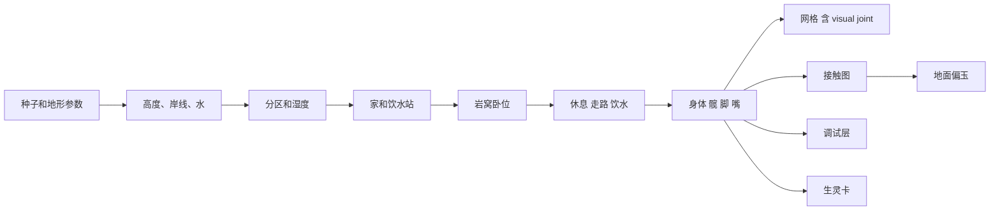
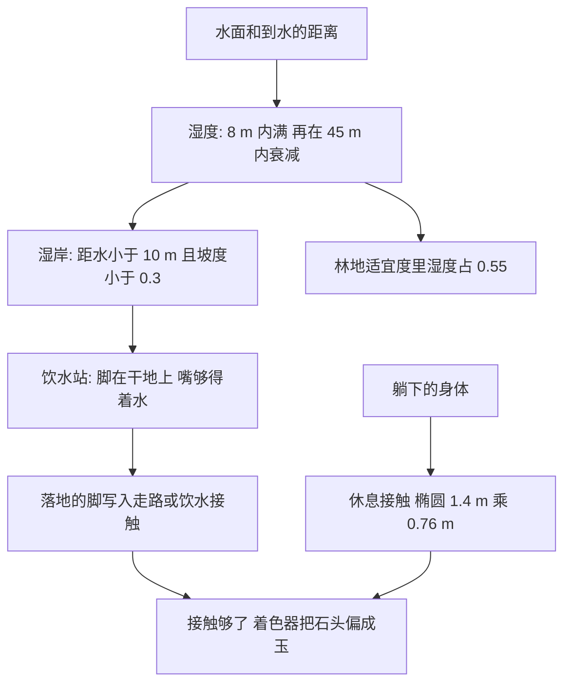

# 白玉岛 · 2026-11-07 界面与生灵调试

下一轮先读本文件，再读 `creature-worldbuilding-checklist.md` 和 `wonderland-handoff.md`。

没有读本周 slides。依据是交接说明里的课堂笔记。

## 打开页面会看到什么

岛占满画面。左侧一条窄的镜头列表，上面一行是种子、第几天、生灵在做什么。右上角是齿轮。调试线默认没有。全部参数从齿轮进入，也可以按反引号 `` ` ``。

## 接手时已有、这轮没覆盖的工作

上一轮未提交的展陈界面还在：`Exhibit.tsx`、`studio.ts`、`JADE_UI`。这轮是在那上面改，没有 reset。未跟踪的 `.pnpm-store/` 和两份课程 PDF 没动。

| 功能 | 上次交接时 | 这轮开始时页面上的实际状态 | 证据 | 问题 |
|---|---|---|---|---|
| 左上介绍卡 | handoff 只写到岩窝，没有这块卡 | `ExhibitLabel`：竖排「白玉岛」、英文标题、种子、第几天、一段章节说明 | `Exhibit.tsx`，截图 `ui-round-2026-11-07/before-simple.jpg` | 挡住岛 |
| 底部五个点 | 计划里写成章节卷轴 | `Handscroll`。点一下飞到一个由规则算出的机位。不是时间 | `chapterViews`，按钮名 Arrival…Jade | 像一段预设剧情，而且挡着岛缘 |
| 时间 | 计划里的日尺还没做 | 在印章抽屉里：1× / 10× / 30×，写入 `Dwelling.speed` | `SealDrawer` | 容易被当成那五个点 |
| 简洁 / 全部参数 | 计划：印章进工作室，反引号退出 | 点「工作室」后印章组件不再渲染。面板用 `SILK_UI`（底 `#f3ecdc`，按钮近黑字绢色） | `ExperimentPage.tsx` 的 `LEVA_THEME`；页面上测到按钮 `rgb(20,18,16)` / `rgb(243,236,220)` | 颜色回到蓬莱；没有明显的返回 |
| 印章 | 计划里的「印」 | 按钮文字就是「印」，红底。`aria-label` 是 Controls | `Exhibit.tsx` | 含义不清 |
| 资源图鉴 | 已有只读图鉴 | 四类都能点开。灌木、草、花、松、石碑有预览模型。生灵、岛、峰、池没有预览，写明不要代理圆锥。世界里的植被、石头、生灵都不能直接点选 | `ResourceAtlas.tsx`，`resourceCatalog.ts` | 卡片和图上的东西没有连起来 |
| 生灵数据 | 模拟在 `dwelling.ts`，网格在 `creature.tsx` | 身体尺寸、脚、髋、嘴、状态、路线、家、卧位、接触图是同一只生灵的数。颈、头、尾、膝只在画的时候算 | 见下面的数据流 | 这些点没有一层可以单独打开 |

## 界面：原来的问题、原因、改了什么、怎么看

**大卡片。** 问题是重复介绍当前场景并挡住画面。原因是展陈方案把博物馆说明做成了 `ExhibitLabel`。改成镜头条里的一行：种子、第几天、状态。截图：`before-simple.jpg` 对 `after-simple.jpg`。

**五个点。** 读代码可以确定它们是镜头，不是时间。每个机位由岛的框架、跌水池或生灵的家算出来，没有手写世界坐标（`chapterViews`）。时间仍是设置里的 1× / 10× / 30×。五个点改成左侧竖条，当前项是实心点加名称。悬停能看到这一镜在看什么。

**简洁和全部参数。** 进全部参数后颜色变旧，是因为 Leva 主题写死了蓬莱的 `SILK_UI`。回不去，是因为工作室打开时整个设置按钮被卸掉，只剩键盘 `` ` ``。现在主题改用 `JADE_UI`。页面上测到按钮底 `rgb(221,230,225)`（雾绿）、字 `rgb(46,51,48)`（墨色），面板底是月白。齿轮一直在。面板右上角有「简洁界面」。刷新后 `dock.hidden === true`（简洁）。切到蓬莱再回来会按是否展陈页重置；同一页里换种子不会把你从全部参数里弹出去。

**齿轮。** 常用的设置图标，`aria-label` 和 `title` 都是 Settings / 设置。

**窄窗口。** 宽度小于 900px 时，镜头条变窄，抽屉不超出屏幕，全部参数打开时齿轮改到左上，避免和右侧面板叠在一起。资源图鉴打开时仍盖住画面（它本来就是一层全屏阅读），关掉回到原来的镜头。

## 生灵调试

默认全关。正常画面不挂这些线。齿轮或全部参数里可以逐项开：

| 开关 | 画什么 | 数从哪来 |
|---|---|---|
| 骨架 | 身体中心、髋、脚，以及颈、头、尾、膝 | 中心、髋、脚、嘴是 `pose`。颈、头、尾、膝是刚摆好的网格，图例写 visual joint |
| 四脚 | 绿 = 落地，红 = 腾空 | `pose.feet` 和 `pose.planted` |
| 状态与目标 | 朝向（墨线）、运动方向（橙色）、目标点 | `pose.heading` 和 `intent`（模拟里本来就有的目标，抄出来给调试看） |
| 路线 | 蓝线 | `dwelling.way`，当前这条路 |
| 地面接触 | 地面按接触图上色 | `map.walk / drink / rest`，不是那条蓝线 |
| 饮水 | 嘴（琥珀）和水面点（蓝）以及连线 | `pose.muzzle` 和 `stand.water` |
| 休息 | 家园锚点小圈，卧位接触椭圆 | 家是 `sites.homes`。椭圆半轴是 `REST_MARK`（沿身体 0.7 m，横向 0.38 m） |

膝的位置和腿网格用同一次计算。不要把它当成骨骼动力学。

页面上打开全部调试后，图例读到：走路、目标是休息处 (−80.8, −105.4) m、朝向 305°、1.10 m/s、脚是「落地、腾空、腾空、落地」。1.10 m/s 就是走路速度常数。Life 镜头的画面里能看到蓝线和地面上的接触色（`debug-life.jpg`）。脚上的小球在这个中景里看不清，脚的落地与否以图例和下面的脚本为准，不把这张图说成脚点已经目视对齐。

关掉七项后图例消失。组件在全关时不挂上，所以正常模式没有调试线。

### 离家 → 饮水 → 回岩窝（脚本，不是画面）

`npx tsx scripts/probe-creature-readout.ts 684,42`

种子 684，家 A 锚点 (−83.0, −105.0)，卧位 (−80.8, −105.4)，饮水站 (−72.1, −45.4)，水面高度 −0.38 m。

| 时刻 | 状态 | 目标 | 路线 | 脚 |
|---|---|---|---|---|
| 0 s | 休息 | 卧位 | 无 | 四脚都落地 |
| 离开的瞬间 | 走路 | 饮水站 | 77 个点 | 仍在卧位，四脚落地 |
| 70.5 s | 饮水，低头进行到 0.67 | 饮水站 | 无 | 两脚落地、两脚还在动 |
| 嘴到水面 | 0.64 m | | | 还没低到底 |
| 140 s | 回到休息 | 卧位 | 无 | 两脚落地、两脚还在收 |

种子 42 的家在 (−17.0, 91.0)，卧位 (−19.1, 91.6)，饮水站 (−33.3, 31.8)。同样走完一趟，位置不是 684 的坐标。

`check-dwelling.ts 684 4` 在饮水完成时，嘴离开水面最多 0.0 cm。上面 0.64 m 是低头到一半的读数，不是最终误差。

## 数据流

| 步骤 | 输入 | 输出 | 单位 | 何时更新 | 文件 | 种子会改什么 |
|---|---|---|---|---|---|---|
| 岛和栖息地 | 种子、山体和水流参数 | 高度格、岸线、分区、湿度 | 米；湿度 0–1 | 参数稳定后整岛重算 | `ground.ts` `zones.ts` `water.ts` | 山、水、哪一块地适合住 |
| 家和饮水站 | 干地、到水的距离、脚必须站在干处 | 最多三个家、一个主要饮水站 | 米 | 岛生成时一次 | `dwelling.ts` `findSites` | 家和饮水站的位置 |
| 岩窝 | 当前的家、周围障碍 | 卧位和门口 | 米 | 切换 A/B/C 时 | `rockShelter.ts` | 窝的朝向和卧位，不改家锚点 |
| 状态和路线 | 卧位、饮水站、障碍 | `rest` / `walk` / `drink`，以及 `way` | 秒；路线是折线 | 每个模拟步，最长 0.05 s | `dwelling.ts` `step` | 路线的弯曲 |
| 姿态 | 状态、地面高度 | 身体中心、髋、四脚、嘴、朝向 | 米；弧度 | 每步 | `pose` | 不直接改尺寸 |
| 接触 | 落地的脚、饮水、躺下 | 三张 0–1 的图 | 每格 0.25 m | 脚落地、饮水中、躺着时 | `ContactMap` | 痕迹的位置 |
| 玉 | 接触图 | 地面颜色 | 无单独矿量 | 大约每 0.1 秒真实时间上传 | `creature.tsx` 交给地形着色器 | 哪里变玉 |
| 调试和卡片 | 上面这些已经算好的数 | 线和卡片文字 | 同上 | 调试开着时每帧；卡片打开时读当前状态 | `creature.tsx` `ResourceAtlas.tsx` | 无新的随机 |

模拟和网格共用：`BODY`、`pose` 的髋、脚、嘴、朝向、躺和低头的程度。网格另外算、模拟不存的：颈根、头的中心、尾巴根、膝盖。这四个在图例里叫 visual joint。

## 形态参数（这轮没有上滑块）

| 参数 | 建议范围 | 默认 | 只改外观？ | 必须共用的数 | 超出时会怎样 |
|---|---|---|---|---|---|
| 尾长 | 0.20–0.55 m | 现在的锥体高 0.32 m | 今天只存在于网格 | 若以后做碰撞，要和岩窝检查用同一个长度 | 再长会伸进背墙。这轮没验证，所以没做滑块 |
| 身体丰满度 | 躯干半长 0.50–0.75，半高 0.26–0.40，半宽 0.22–0.34 m | 0.62 / 0.32 / 0.27 | 否。身高影响岩窝净空，身长影响嘴能伸多远 | `BODY.torso`，模拟和网格都读它 | 太高会顶到顶板（净空现在约 2.05–2.11 m）；太宽会和侧墙重叠 |
| 脚 / 腿比例 | 先别改髋的间距。小腿视觉长度跟站立身高走 | 髋在身体前后 0.42 m、左右 0.17 m | 髋一改，落脚点就改 | 落脚用 `BODY.hips`。膝只是视觉 | 髋外移会让脚进水或进墙；只拉长视觉小腿不会挪脚印，但腿会被拉长 |
| 角高 | 0.10–0.28 m | 锥体 0.20 m | 看起来是外观。岩窝脚本会在嘴的上方打一个点，角变高可能判成穿石 | 网格和 `probe-rock-shelter.ts` 的穿石点要用同一个高度 | 太高会在躺下时顶到顶板 |

一次只做一个，并先跑 `probe-rock-shelter.ts` 和 `check-dwelling.ts`。这轮四个都没做成滑块。

## 资源卡

生灵卡没有单独的预览模型。打开后写的是「岛上的真实实例」：名称、这只的站立尺寸（从 `BODY` 量的）、当前状态和第几天、上面的生成规则摘要。按钮「显示生灵调试」会打开全部调试并关掉图鉴，镜头回到打开图鉴之前。

灌木、草、花、松、石碑的旋转预览标成「图鉴预览样本」，不是你在岛上点中的那一株。

世界里点选：设置里的「点选生灵」会暂停拖拽和摇镜头，滚轮还能用。点中生灵后打开这张卡，并写明是刚在岛上点中的。Esc 或再关一次选择模式就退出。植被、石头、水的点击这轮没有做。建议以后用同一种记录：`{ kind, id, source: 'scene' | 'preview' }`。只有 `kind: 'creature'` 接上了。

这一点的页面目视没有完成：没有把指针点到生灵身上。接线是读代码确认的。

## 水与石

实际规则：湿度、湿岸、林地、哪里能喝水、三种接触、接触变成地面颜色。

美术隐喻：玉不是单独的矿层，没有矿物生成或溶解。白瓷身体也不是一种岩石类型。水不会因为生灵去喝而变少。

## 已有作品

1. [Red Blob Games, mapgen4](https://www.redblobgames.com/maps/mapgen4/)。地图和生成步骤可以对着看。适合借的是「一条规则配一小块能看的场」。不适合把整页做成地图编辑器，岛已经由种子决定。
2. [Dwarf Fortress 的 Legends](https://dwarffortresswiki.org/index.php/Legends)。历史是模拟事件写出来的。适合借的是生灵卡片上的状态和接触记录来自同一次模拟。不适合做一整部编年，这里只有一只生灵。
3. [Townscaper 的界面取舍（PC Gamer 对作者的访谈）](https://www.pcgamer.com/townscapers-developer-on-how-its-radically-casual-design-is-inspiring-a-new-wave-of-low-stress-builders-to-adapt-the-blueprint)。适合借的是访客不要面对一堵滑块。不适合学它把规则藏起来：这门课要看得规则。分层拆开生成是作者演讲里的方法，不是这个游戏自己的界面，这轮不要再做一个。

## 检查

| 命令 | 结果 | 属于 |
|---|---|---|
| `npx tsc --noEmit -p .` | 通过 | 读代码 / 类型 |
| `npx tsx scripts/check-world.ts 684,42` | 两条都是 all rules hold。684 岩窝净空 2.11 m，42 是 2.05 m。10 个来回，脚不打滑、不进水 | 脚本通过 |
| `npx tsx scripts/check-dwelling.ts 684 4` | 4 个来回。嘴在喝完时离水面最多 0.0 cm。脚滑 0.0 cm | 脚本通过 |
| `npx tsx scripts/probe-rock-shelter.ts 684,42` | shelter checks passed。684 A 与 42 A 的进出都 ok | 脚本通过 |
| `npx tsx scripts/probe-creature-readout.ts 684,42` | 上面那张表。两个种子的家不在同一坐标 | 脚本通过 |
| 简洁界面、齿轮、全部参数的颜色、退出、刷新后面板隐藏 | 在 1280×800 的页面上读到 DOM | 页面目视 + 读 DOM |
| Life 镜头下的蓝线和接触色 | `debug-life.jpg` | 页面目视。脚上的小球没有在这张图里看清 |
| 点中生灵打开卡片 | 未做 | 未验证 |
| 水系专项 `check-water.ts` | 这轮没单独跑。`check-world` 只引用了它的连续性说明 | 未验证 |
| GPU 时间 | 未测 | 未验证 |

调试层关掉时不创建那些线。打开后每帧改线的顶点，并在接触开关打开时沿用原来的地面接触贴图。没有新增模拟。性能影响：默认和改前一样；七项全开时多一批线，没有重测帧时间。

截图在 `docs/ui-round-2026-11-07/`。`before-simple.jpg` 是改之前的大卡片。`after-simple.jpg` 是镜头条。`after-studio.jpg` 是全部参数。`debug-life.jpg` 是 Life 镜头下的路线和接触。
