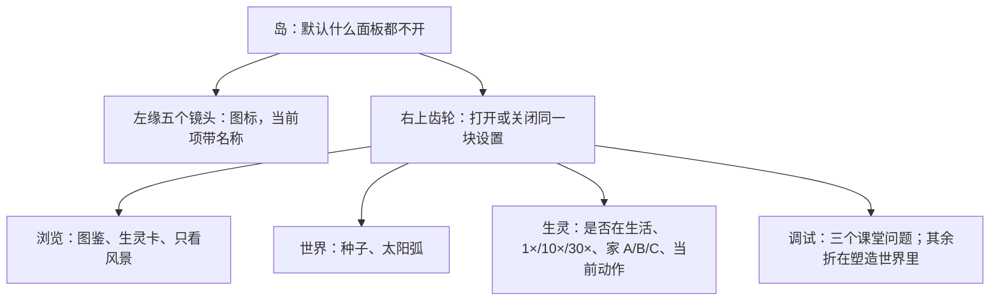

# 白玉岛界面改版方案（2026-11-08）

这一轮只审查、不改功能。下一轮按文末的阶段做。没有读本周 slides。

稳定版本指已提交的 `007494a`。当前页面是工作区里还没提交的展陈界面，比那次提交多了一整层壳。

## 继承与变化

| 东西 | 已提交的稳定版 | 未提交的改动实际做了什么 | 现在打开页面是什么样 | 留还是改 | 证据 |
|---|---|---|---|---|---|
| 默认镜头 | 画布初始机位 `[-430, 300, 380]`，看向 `[-20, 10, 0]` | Arrival 在岛算完后立刻改机位：高 420 m，水平距离 720 m，看向 `[0, 18, 0]` | 种子 684 上实测相机 `[-588.2, 420, 415.2]`，目标 `[0, 18, 0]`。岛的主体不在画面正中，窄窗口里更偏右下 | 五个机位的算法留着。只改 Arrival 的目标和距离 | 代码 `chapterViews`；页面读到的相机。岛宽 560 m、深 440 m 来自 `layout.ts` |
| 左侧导航 | 没有。参数在右侧 Leva | 先做过底部队列，后来改成左上角常驻卡片：种子行、大写标题、五个带图标和副标题的按钮 | 宽窗口卡片宽 220 px。393 px 宽的窗口里实测 172×317 px，占宽 44%、占高 44%。Arrival 是浅色底加箭头 | 入口留着，卡片缩小 | 样式 `.exhibit .exhibit-cameras`；页面量到的矩形 |
| seed / day / state | 种子在 Island 面板。时刻是太阳弧。生灵状态在 Dwelling | 三样写成卡片顶上的一行。`day` 用的是往返次数 `cycles`，不是太阳的小时 | 模拟跑起来之后会显示成 `seed 684 day 16 walking` 这种句子 | 拆开。不要再并列 | `ExhibitStatus` 把 `dwellStats.cycles` 填进 `day {n}`。`cycles` 在回家躺下时加一 |
| 时刻仪表 | Leva 的 `sunArc`：可拖的太阳弧，默认 15 点，管天空和光 | 展陈页把整个 Leva 藏起来。设置里改成一根 0–24 的滑杆，仍写入 `Light.hour` | 打开设置能看到 `Time of day 15.00`。太阳弧不在画面上 | 滑杆换成原来的弧，不要新做一只钟 | `useHour` 仍注册 `sunArc`。`ExperimentPage` 里 `hidden={exhibit \|\| !studio}` |
| 齿轮和参数面板 | 右侧 Leva 一直开着，约 300 px，宋体、绢色 | 齿轮打开自写的整页高抽屉，宽最多 380 px。Leva 仍挂着同一批数值，但这页不显示。没有「简洁 / 工作室」切换 | 齿轮在右上。抽屉打开后齿轮透明度变成 0。分组是探索、画面与视角、岛屿与生灵、塑造世界、生灵调试 | 一个齿轮开关这一块。分组方向对，抽屉在窄窗口上太大 | 页面读到抽屉 380×679，以及那些分组标题 |
| 资源图鉴 | View 里的 Resources 按钮 | 改到设置的「岛屿图鉴」 | 能从设置打开。点生灵也会打开生灵卡（展陈页里点击一直开着） | 留 | `onResources`；`selecting: exhibit` |
| 生灵调试 | 一个「接触调试」开关 | 七个底层开关，设置里收成三组：行动与路径、接触与栖居、身体结构。默认关 | 正常画面没有调试线。打开一组会同时打开好几项 | 课堂只留三问。七个开关留在塑造世界里 | `SettingsDrawer` 的 `debugGroups` |
| 岛的样子 | 白石、浅水、灰绿褶、赭色植被 | 界面换了，地形、水、岩窝、山色没有改 | 截图里岛仍是这套颜色 | 全部留下，不要为界面重调 | 本轮没有改那些文件 |

## A. 当前问题

**挡住世界**

1. 左卡片在窄窗口里占将近一半画面。宽 220 px（窄于 760 px 时 172 px），内边距 14 px，每项至少 53 px 高，还有图标、副标题和箭头。证据：样式表；393×723 的页面上量到 172×317。
2. Arrival 不看岛的中心。目标写死在世界原点上方 18 m。种子 684 的盆地大约在 (75, −4)，离原点约 70 m。再叠上左边那块卡片，岛就偏到右下。证据：实测相机和目标；`ISLAND` 为 560×440 m。竖长窗口的水平视野装不下 560 m，这是比例问题，不单是卡片。
3. 设置抽屉用 `position: fixed`，宽 380 px、高为整页减去顶栏。393 px 宽的窗口上它盖住整屏。打开后齿轮还被设成看不见。

**不好理解**

4. `seed 684 / day 16 / walking` 把三件不同的事写成一句。种子是生成参数。`day` 其实是「走去喝水再回家」的次数，大约每 14 秒真实时间加一（10 倍速时一趟约 140 模拟秒）。`walking` 是这一刻的动作。新人无法从这句看出石头怎么变成玉。
5. 原来的时刻控制还在代码里，是 `world.tsx` 的太阳弧，默认下午 3 点，只影响光和天空。展陈页把它藏了，设置里只剩一根滑杆。1× / 10× / 30× 是生灵模拟的快慢，不推动太阳。Leva 里还有 100×，这个抽屉没有。
6. 五个镜头按钮像一列菜单，不像「点一下换机位」。副标题（The whole island 等）和箭头增加了阅读，没有增加能去的地方。

**视觉不统一**

7. 岛是温白石和灰绿。卡片却是大圆角、重阴影、大写无衬线标题、系统字体。设置标题用 1.6 rem。这是另一套界面放在岛上面，不是把界面让给岛。
8. 齿轮、镜头图标已经是同一套细线图标。不要再生成一套图片图标。

**性能**

9. Arrival 这一镜：59 次绘制，约 123 万三角。这是场景本身。强制调用 `gl.render` 只花 0.1–0.5 ms，那是提交时间，不是显卡画完的时间。设备像素比从 1.8 降到 1.25，说明这一会话里显卡帧曾经超过 14 ms 的预算，但不是对这一镜新测的。工具标签页里 2.5 秒只来了 1 帧，那是标签页被节流，不能写成岛只有 0.4 帧。

## B. 信息放哪

默认浏览时，岛上只有左缘镜头和右上齿轮。种子不常驻。太阳的小时不常驻。生灵动作不常驻。

点生灵或「认识生灵」才看到它的名字、尺寸和当前动作。调试打开时，图例出现在右下，设置开着时让到抽屉左边。

## C. 两种布局

推荐第一种。

**第一种：收起的竖条。** 左缘距边 12 px。五个按钮各 36×36 px，间距 6 px。只显示现有的细线图标。当前项在图标右侧多出名称，例如「Arrival」，不要副标题，不要箭头。整条最宽约 120 px，高约 210 px。齿轮 40×40，距右上 12 px。设置抽屉宽 320 px，从顶栏下缘开始；宽于 760 px 时停在右边。窄于 760 px 时改为从底部升起，最高 70% 屏高，右上角保留关闭。种子、太阳弧、生灵快慢都在抽屉里，不在岛上。

理由：窄窗口不再被 172 px 的卡片切掉近半。五个图标能认（山、水、叶、菱形已经画在 `CameraIcon` 里）。当前项仍有文字，悬停仍用现成的 `title` 说明这一镜在看什么。

**第二种：把现在的卡片收矮，仍常驻。** 去掉「Explore the island」、副标题和箭头，五项改成单行 32 px，卡片宽 160 px。种子行删掉。

不推荐作为最终样子。160 px 在 393 px 宽的窗口里仍占四成，Arrival 的岛还是会被挡住。只适合作为第一阶段的过渡，如果收成纯图标后名称不够清楚，再退回这一档，而不是退回现在的大卡。

Arrival 构图（两种布局都要做）：看向盆地和主脉中点的平均位置，不要看世界原点。距离按「560 m 的岛宽放进扣掉左条之后的画面，左右各留约 8%」来算。竖屏若装不下，再抬高相机，不要把卡片加大。山、水、生、玉四个机位先不动。

## D. 不要重做的部分

白石、水、灰绿山褶、植被、岩窝、种子规则、1 米等于 1 米。五个机位的算法，除 Arrival 的目标和距离。齿轮这个图标。设置分组的名字：探索、画面、岛屿与生灵、塑造世界。Leva 继续当数值的仓库，这页继续不显示它的面板。资源图鉴和生灵卡。生灵的模拟、接触图和玉的着色。调试默认关闭。山色、曝光、太阳高度曲线、水面都不要为了这次界面去改。

## E. 生灵调试怎么减

课堂演示只留三个开关，都在设置的「调试」里，默认关：

| 开关 | 回答的问题 | 打开时画什么 | 原来的哪几项 |
|---|---|---|---|
| 它为什么在这里喝 | 饮水点是岸上、脚还干着、嘴够得到的地方 | 水面点、嘴、两者的连线，加一行当前动作 | 现在的饮水和状态 |
| 它怎样走回去 | 蓝线是计划的路，不是已经留下的痕迹 | 当前 `way` | 现在的路线 |
| 脚印怎样变成玉 | 接触图才是留下的颜色 | 地面上的接触色 | 现在的接触 |

四脚的落地和腾空并进「它怎样走回去」，只在走路时显示，不再单独成开关。休息时的椭圆并进「脚印怎样变成玉」，只在它躺着时显示。骨架（含 visual joint）从课堂列表拿掉，放进「塑造世界」那一栏的最下面，给排错用，默认关。底层那七个 Leva 值先留着，避免调试能力被删掉；访客列表不要再一次打开三四个。

## F. 性能

测量环境：本机 Chrome 工具页，Windows，设备像素比 1.8，画布后来用 1.25。种子 684，Arrival 机位。工具页会节流动画帧，所以帧率那一列不能当成玩家机器上的帧率。

| 情况 | 绘制次数 | 三角 | 帧时间 | 说明 |
|---|---|---|---|---|
| 默认，面板和调试都关 | 59 | 1,231,846 | 提交 0.1–0.5 ms；显卡时间未测 | 实测 `gl.info`。提交时间不是显卡时间 |
| 打开设置 | 未单独再数 | 未再数 | 点击到画出抽屉的时间无效 | 工具页两帧之间停了很久，不能把那段算成界面卡顿。抽屉是 DOM，约 257 个节点，不增加地形三角 |
| 打开图鉴 | 未测 | 未测 | 未测 | 图鉴是盖住画面的一层 DOM |
| 打开一项或全部调试 | 未测 | 未测 | 未测 | 代码上：接触会继续每 0.1 秒上传贴图；线和脚标在调试组件挂上之后每帧改顶点。默认不挂这些对象 |
| Arrival 切到 Life | 未测 | 未测 | 镜头本身动画 2.4 秒 | 卡一下更可能来自近处草和细节层次，不是来自左侧按钮 |
| 连续缩放、拖动 | 未测 | 未测 | 未测 | 不要先降画质。先确认是不是近处草的重建 |

像素比会在显卡帧超过 14 ms 时自动下降。这次只观察到它已经是 1.25，没有新的显卡计时。

## G. 实施顺序

每一阶段都可以单独看，不行就只退该阶段的文件。

1. **Arrival 构图。** 只改 `Exhibit.tsx` 里 `arrival` 的 `from` 和 `to`。风险：总览裁切。验收：种子 684，1440×900 和约 400 px 宽各看一次，盆地在未被左条挡住的区域中部，岛的外缘不被切掉一半。回退：恢复现在的 `fx * 720`、高度 420、目标 `[0, 18, 0]`。
2. **左条变小。** 改 `index.css` 的 `.exhibit .exhibit-cameras`，并在 `CameraRail` 去掉常驻副标题、箭头和大写标题。名称只留在当前项。风险：五个图标认不出。验收：窄窗口左条宽不超过约 120 px；当前项有字；悬停仍有原来的说明。回退：恢复这一段样式和按钮里的 `<small>`。
3. **拆开那一行状态。** `Scene.tsx` 不再把 `ExhibitStatus` 放进左条。种子留在「岛屿与生灵」（那里已经有）。动作和往返次数只出现在生灵卡和图例。文案不要再用 day 称呼往返次数。风险：演示时找不到种子。验收：默认画面没有这句；打开设置能改种子；打开生灵卡能看到它在走路还是在休息。回退：把 `ExhibitStatus` 放回去。
4. **太阳弧放回设置。** 用现有 `sunArc.tsx` 的画法，绑定已经在用的 `Light.hour`，换掉那根 0–24 滑杆。1× / 10× / 30× 留在生灵那一组，旁边写明这是生灵的快慢。风险：弧和滑杆写到两个地方。验收：拖弧，光在变；快慢只改变生灵，不改变太阳。回退：恢复那根滑杆。
5. **调试收成三问。** 改 `SettingsDrawer` 的分组，不要删 `dwelling.ts` 的记录。风险：课堂开关和底层开关不同步。验收：默认无调试线；三个开关分别只多出喝水、路线、接触；骨架仍能在「塑造世界」里打开。回退：恢复现在的三组复选框。
6. **窄窗口的抽屉。** 宽 320 px；窄于 760 px 时从底部升起，并保留看得见的关闭。齿轮在抽屉打开时不要设成 `opacity: 0`。风险：和左条重叠。验收：393 px 宽时岛仍能看见一块；关闭后回到只有左条和齿轮。回退：恢复现在的 fixed 抽屉。

不要在这些阶段里改山色、水、岩窝或草的生成。

## H. 访客会怎样看

打开页面，先是这座白石岛，左边只有五个小图标，右上角一个齿轮。点山、水、生、玉会把镜头缓缓移到对应的地方，当前图标旁边写着名字。种子在齿轮里的「岛屿与生灵」，换种子会换一座同一套规则的岛。一天里的光仍是原来的太阳弧，拖它只改变光照。生灵自己的快慢是旁边的 1×、10×、30×，它每走完一趟喝水再回家，次数才增加，这不是时钟。想看它为什么在那一处喝、怎样走回去、脚印怎样把石头染成玉，就打开调试里对应的一项，看完关掉，岛还是主角。
